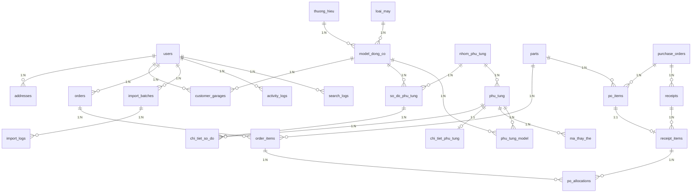

# KIẾN TRÚC DỮ LIỆU JPM (DOMAIN-DRIVEN DESIGN DATABASE)

> **Cảnh báo (Single Source of Truth):** Tài liệu này là phiên bản thiết kế Database chuẩn mực và duy nhất của JPM, được xây dựng theo chuẩn **Domain-Driven Design (DDD)**. Bất kỳ sự thay đổi (Thêm/Bớt/Gộp bảng) nào trong tương lai đều phải xuất phát từ thay đổi nghiệp vụ kinh doanh thực tế, tuyệt đối không được gộp bảng chỉ vì mục đích "rút gọn" số lượng bảng hay đơn giản hóa lập trình.

Kiến trúc Database được chia thành 9 Domain độc lập, giải quyết triệt để 100% mô hình kinh doanh Part Catalog + Order Management, sẵn sàng mở rộng và hoạt động ổn định trong ít nhất 10 năm tới.

---

## 1. IDENTITY & CRM DOMAIN (Khối Định danh & Khách hàng)
Domain quản lý định danh người dùng và khách hàng mua sắm.
*   **`users`**: Bảng trung tâm (id, user_code, name, email, password, phone, avatar, status, created_at, updated_at).
*   **`addresses`**: Liên kết N-1 với user (id, user_id, address_line, city, state, country, zip_code, `address_type` [billing, shipping], is_default).
*   **`customer_garages`**: Lưu trữ máy móc sở hữu (id, user_id, `model_dong_co_id`, serial_number, year, notes). 
*(Hệ thống Phân quyền Role/Permission sẽ sử dụng chuẩn package Spatie Laravel).*

## 2. KHỐI DANH MỤC THIẾT BỊ (Equipment Catalog Domain)
Cấu trúc thực dụng theo phong cách quản trị ERP, tách bạch rõ ràng giữa Hãng và Loại máy.
*   **`thuong_hieu`**: Hãng sản xuất độc lập (id, ma_thuong_hieu, ten_thuong_hieu, logo, slug, trang_thai).
*   **`loai_may`**: Loại thiết bị / Dòng sản phẩm độc lập dùng chung cho mọi hãng (id, ma_loai_may, ten_loai_may, slug, trang_thai). Ví dụ: Máy phát điện, Động cơ ngoài.
*   **`model_dong_co`**: Phiên bản giao thoa và chi tiết nhất (id, thuong_hieu_id, loai_may_id, ma_model, ten_model, ma_luc, nam_bat_dau, nam_ket_thuc, slug, trang_thai).

## 3. PIM & PART CATALOG DOMAIN (Khối Quản lý Dữ liệu Phụ tùng - LÕI)
Domain khổng lồ nhất, phục vụ việc tra cứu và nhập liệu.
*   **`nhom_phu_tung`**: Danh mục nhóm để phân loại phụ tùng (id, parent_id, ma_nhom, ten_nhom, slug, trang_thai).
*   **`phu_tung`**: Bảng cốt lõi siêu nhẹ (id, thuong_hieu_id, nhom_phu_tung_id, ma_phu_tung, ten_phu_tung, gia_ban, trang_thai).
*   **`chi_tiet_phu_tung`**: Thuộc tính vật lý (id, phu_tung_id, weight, dimensions [JSON], origin_country, hs_code, specifications [JSON]).
*   **`ma_thay_the`**: Vòng đời mã phụ tùng (id, phu_tung_id, ma_cu, ma_moi, loai_thay_the).
*   **`phu_tung_model`**: Liên kết rạch ròi N-N (id, phu_tung_id, model_dong_co_id, notes). *(Nguyên tắc: Không dùng Polymorphic nối lẫn lộn, fitment phải trỏ đích danh Model).*
*   **`so_do_phu_tung`**: Bảng lưu Sơ đồ rã (id, model_dong_co_id, nhom_phu_tung_id, ten_so_do, hinh_anh, thu_tu, trang_thai).
*   **`chi_tiet_so_do`**: Tọa độ cho ảnh Sơ đồ nổ (id, so_do_phu_tung_id, phu_tung_id, ref_number, x_coord, y_coord, width, height, qty_required).

## 4. SEARCH & ANALYTICS DOMAIN (Khối Lịch sử Tra cứu)
Domain phục vụ phân tích hành vi tìm kiếm của thợ/khách hàng, từ đó tối ưu PIM.
*   **`search_logs`**: (id, keyword, filters [JSON], results_count, user_id, ip_address, session_id, searched_at).
*   **`search_synonyms`**: (id, keyword, synonym). VD: Khách gõ "Curoa" tự hiểu là "Timing Belt".

## 5. SALES & ORDER DOMAIN (Khối Đơn hàng)
*   **`carts`** & **`cart_items`**: Quản lý giỏ hàng theo Session/User.
*   **`orders`**: (id, user_id, address_id, status, subtotal, shipping_fee, total, `order_type` [b2b, b2c], notes).
*   **`order_items`**: (id, order_id, part_id, qty_ordered, price, `qty_fulfilled`).
*   **`payments`**: (id, order_id, amount, payment_method, transaction_id, status).

## 6. PROCUREMENT & RECEIVING DOMAIN (Khối Nhận hàng & Cross-Docking)
Thay thế hệ thống Quản lý kho (WMS) rườm rà. Tập trung chính xác vào luồng Order-to-Delivery.
*   **`purchase_orders`**: PO gửi Nhật Bản (id, po_number, supplier_name, status, expected_delivery_date).
*   **`po_items`**: (id, po_id, part_id, qty_ordered, `qty_received`).
*   **`receipts`**: Phiếu nhận lô hàng về VN (id, po_id, tracking_number, received_at, status).
*   **`receipt_items`**: Số lượng thực tế bung khỏi kiện hàng (id, receipt_id, po_item_id, part_id, qty_received).
*   **`po_allocations` (Cross-Docking Core)**: (id, receipt_item_id, order_item_id, allocated_qty, status). Bảng ánh xạ thần thánh báo cho Staff biết món hàng vừa cầm trên tay (từ receipt) thuộc về Đơn Khách Hàng nào (từ order).

## 7. IMPORT & DATA PIPELINE DOMAIN (Khối Nhập liệu hàng loạt)
Đảm bảo Import 100,000 dòng Excel không bị rủi ro đứt gãy.
*   **`import_batches`**: (id, file_name, file_path, status [pending, processing, completed, failed], created_by).
*   **`import_logs`**: (id, import_batch_id, row_number, status, error_message, raw_data [JSON]).

## 8. ATTACHMENT & DOCUMENT DOMAIN (Khối Đính kèm file)
*   **`attachments`**: Bảng Polymorphic đa năng (id, `attachable_type`, `attachable_id`, file_name, file_path, mime_type, file_size, metadata [JSON], created_by, created_at). Phục vụ đính kèm file PDF hóa đơn, catalog rời, hoặc file scan.

## 9. AUDIT & ACTIVITY DOMAIN (Khối Truy vết & Giám sát)
*   **`activity_logs`**: (id, `loggable_type`, `loggable_id`, action [created, updated, deleted], before_value [JSON], after_value [JSON], changed_by, changed_at). Dùng để truy vết lỗi khi giá bán hoặc tọa độ sơ đồ bị sửa sai.

---

## 10. SƠ ĐỒ THỰC THỂ LIÊN KẾT TỔNG THỂ (CORE ERD)

