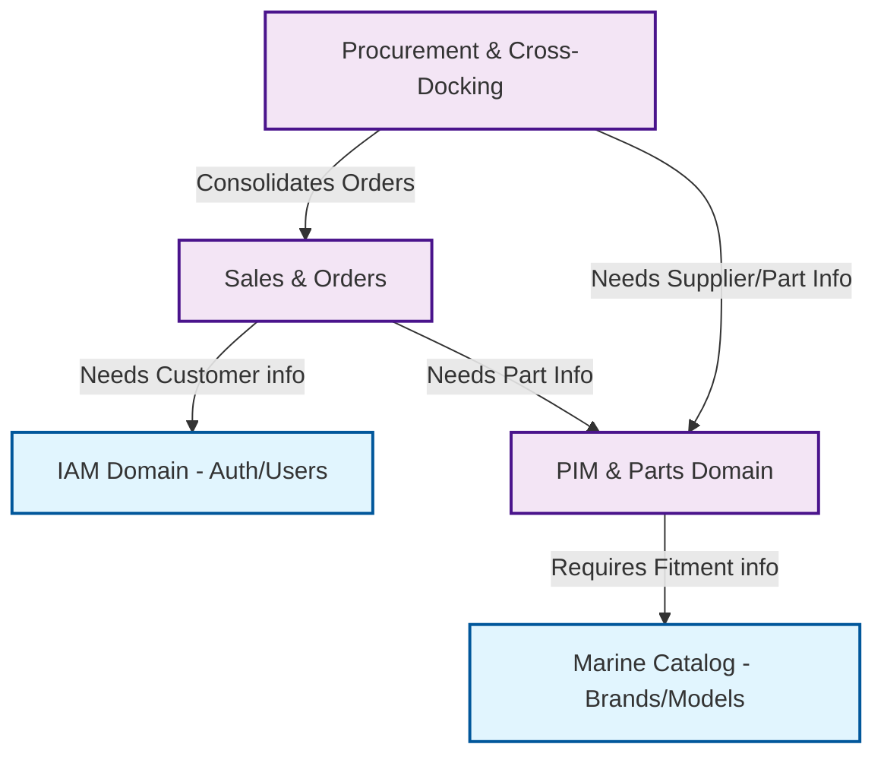

# KIẾN TRÚC MÃ NGUỒN JPM (CODE ARCHITECTURE)

> **Nguyên tắc chi phối:** Domain-Driven Design (DDD), Business Flow Organization, Separation of Concerns.
> **CẢNH BÁO:** Dự án **tuyệt đối không** sử dụng kiến trúc Flat MVC (gom toàn bộ Controller/Model vào chung một thư mục) như những ứng dụng nhỏ lẻ. Bắt buộc phải áp dụng **Modular Monolith** theo các khối nghiệp vụ (Domain).

Tài liệu này là thiết kế Kiến trúc Mã nguồn (Code Architecture) chuẩn mực. Mục tiêu là code có thể mở rộng lên hàng triệu dòng trong 10 năm mà không bị rác (Spaghetti Code).

---

## 1. CẤU TRÚC THƯ MỤC BACKEND (LARAVEL - DDD APPROACH)
Thay vì nhét mọi thứ vào `app/Models` hay `app/Http/Controllers`, JPM sử dụng kiến trúc **Domain-Driven Directory Structure**. Mọi thứ được nhóm theo khối nghiệp vụ đã chốt ở tài liệu Database.

```text
app/
├── Domain/                   # Tầng Nghiệp Vụ Cốt Lõi (Độc lập với HTTP)
│   ├── IAM/                  # (Identity & CRM) Users, Addresses, Garages
│   ├── MarineCatalog/        # (Danh mục Máy thủy) Brands, Engines, Models
│   ├── PIM/                  # (Phụ tùng & Sơ đồ) Parts, Diagrams, Hotspots
│   ├── Sales/                # (Bán hàng) Carts, Orders, Payments
│   └── Procurement/          # (Cross-docking) POs, Receipts, Allocations
│       ├── Models/           # Models thuộc riêng về Domain này
│       ├── Services/         # Service Layer (Logic nghiệp vụ phức tạp nằm đây)
│       ├── Repositories/     # Data Access Layer (Chỉ chứa query DB phức tạp)
│       └── DTOs/             # Data Transfer Objects (Định dạng dữ liệu luân chuyển)
│
├── Http/                     # Tầng Giao Tiếp (HTTP / API)
│   ├── Controllers/
│   │   └── Api/V1/
│   │       ├── MarineCatalog/    # Chứa các Controller cho Catalog
│   │       ├── PIM/
│   │       ├── Sales/
│   │       └── Procurement/      # Chứa PoController, ReceiptController...
│   ├── Requests/                 # FormRequest Validation (Tổ chức theo Domain)
│   ├── Resources/                # API Resources để format JSON trả về (Tổ chức theo Domain)
│   └── Middleware/               # Middleware xác thực, check quyền
│
└── Infrastructure/           # Tầng Giao Tiếp Bên Ngoài (Zalo API, Payment Gateway)
```

## 2. CẤU TRÚC THƯ MỤC FRONTEND (VUE 3 - SINGLE UNIFIED VIEW)
Frontend tổ chức rạch ròi theo 2 phân hệ **Admin & Staff (`views/admin/`)** và **Khách hàng (`views/client/`)**, tuân thủ nguyên tắc **"Code một thể thống nhất - Tuyệt đối không xé lẻ lắt nhắt"**.

### 2.1. Cấu trúc thư mục thực tế (`FE_JPM/src/`)
```text
src/
├── views/                    # Toàn bộ màn hình giao diện (Single Unified Views)
│   ├── admin/                # Phân hệ Quản trị & Vận hành nội bộ (Theme Sneat)
│   │   ├── BanHang/          # DonHang.vue (Yêu cầu, Báo giá, Gom PO Nhật, Duyệt cọc)
│   │   ├── MayThuy/          # ThuongHieu.vue, DongCoModel.vue, LoaiDongCo.vue
│   │   ├── PhuTung/          # PhuTung.vue, SoDoPhuTung.vue (Tool map sơ đồ nổ)
│   │   ├── LinhKien/         # MaThayThe.vue, CapNhatLinhKien.vue
│   │   ├── Kho/              # Kho.vue, TonKho.vue, TheKho.vue
│   │   ├── NhanSu/           # NhanVien.vue, PhanQuyen.vue
│   │   └── HeThong/          # CauHinhHeThong.vue, DanhSachThongBao.vue
│   │
│   ├── client/               # Phân hệ Khách hàng & Cửa hàng (Theme TheEvent)
│   │   ├── guest/            # TrangChu.vue, SoDoPhuTung.vue, ChiTietSanPham.vue, GioHang.vue...
│   │   └── customer/         # Garage.vue, LichSuDonHang.vue, TaiKhoan.vue...
│   └── auth/                 # XacThuc.vue (Đăng nhập, Đăng ký, Quên mật khẩu)
│
├── layout/                   # Khung Layout dùng chung (LayoutAdmin, LayoutClient, LayoutAuth)
├── stores/                   # Pinia State Management (authStore.js, cartStore.js)
├── api/                      # axiosClient.js (Cấu hình baseURL, Interceptor Bearer Token)
├── utils/                    # offlineSyncService.js (IndexedDB hàng đợi offline)
└── router/                   # index.js (Định tuyến Kebab-case, Auth & Permission Guards)
```

### 2.2. Nguyên tắc "Code một thể thống nhất" (Single Unified View - Cấm xé nhỏ)
* **Không xé nhỏ thành các component con lắt nhắt:** Toàn bộ cấu trúc của một trang (Khối tiêu đề, Bộ lọc tra cứu, Lưới Card / Bảng dữ liệu, Nút hành động, và cả Popup Modal tương tác) bắt buộc phải được code trọn vẹn trong **CÙNG MỘT FILE `.vue` DUY NHẤT**.
* **Lợi ích thực chiến:** 
  1. Luồng dữ liệu chạy thông suốt từ trên xuống dưới, không cần truyền `props` hay `emit` qua nhiều tầng component ảo phức tạp.
  2. Mọi logic (State, Watcher, Computed, Modal handler) nằm ngay trước mắt, dễ bảo trì, dễ sửa lỗi và dễ tái sử dụng.
  3. Tránh hoàn toàn tình trạng phân mảnh mã nguồn (Over-componentization). Mọi page tiếp theo bắt buộc phải tuân thủ nghiêm ngặt nguyên tắc này giống như `TrangChu.vue`.

## 3. THIẾT KẾ CÁC TẦNG KIẾN TRÚC KỸ THUẬT

### 3.1. API & Request Layer
*   **Routing:** Mọi Route phải được phân nhóm theo Domain trong `routes/api.php` bằng `Route::group`.
*   **Request Layer:** Controller tuyệt đối không tự validate dữ liệu. Mọi Input phải đi qua `app/Http/Requests`.

### 3.2. Controller Layer
*   **Nguyên tắc "Mỏng" (Thin Controller):** Controller CHỈ ĐƯỢC làm 3 việc: Nhận Request đã validate -> Gọi Service Layer tương ứng -> Trả về API Resource. Controller không chứa lệnh `if/else` nghiệp vụ dài dòng hay câu truy vấn `where` của Eloquent.

### 3.3. Service Layer Architecture
Đây là trái tim của hệ thống.
*   **Nguyên tắc "Dày" (Thick Service):** Mọi logic tính toán (VD: Logic Gom Đơn PO, Tính phí Ship, Match hàng Cross-docking) phải nằm trong thư mục `Domain/.../Services/`.
*   Mỗi Service chỉ làm một nhiệm vụ (Single Responsibility). Ví dụ: `CrossDockingAllocationService` chỉ làm nhiệm vụ tính toán xem lô hàng Nhật vừa về sẽ được chia cho những đơn nào.

### 3.4. Resource Layer
*   Frontend không bao giờ được nhìn thấy tên cột Database thật. Eloquent Resource làm nhiệm vụ ẩn giấu ID thật, đổi tên biến chuẩn `camelCase` cho VueJS tiêu thụ, và bọc metadata phân trang thống nhất.

## 4. QUY TẮC ĐẶT TÊN VÀ ĐỊNH TUYẾN (CONVENTIONS)

### 4.1. File & Namespace Convention
*   **Backend:** Theo chuẩn PSR-4 của Laravel. Class name là `StudlyCaps`, Method name là `camelCase`. Namespaces phải phản ánh đúng thư mục (VD: `App\Domain\Procurement\Services`).
*   **Frontend:** 
    *   Tên Component: `PascalCase` (VD: `DiagramViewer.vue`). Không dùng tên chung chung như `View.vue` hay `Index.vue`.
    *   Tên views: Hậu tố báo hiệu đây là một trang (VD: `DiagramDetailPage.vue`).

### 4.2. Dependency Rule (Quy tắc Gọi chéo)
Để tránh hệ thống dính liền vào nhau (Tight Coupling), quy định chiều gọi như sau:
*   Controller $\rightarrow$ Gọi Service.
*   Service $\rightarrow$ Gọi Repository/Model.
*   **Cross-Domain:** Nếu Service ở `Sales` cần lấy thông tin Phụ tùng từ `PIM`, nó phải gọi `PartService` của `PIM`, **Tuyệt đối không được** tự ý query trực tiếp vào `PartModel` của Domain khác.

---

## 5. BẢN ĐỒ PHỤ THUỘC MODULE (MODULE DEPENDENCY DIAGRAM)



> **Kết luận:** Với cấu trúc này, khi Team phát triển cần sửa lỗi về tính năng Quét mã vạch Cross-Docking, họ chỉ cần mở đúng Domain `Procurement` ở Backend và module `AdminCrossDocking` ở Frontend. Không ai giẫm chân lên code của ai. Mọi thứ được cô lập và an toàn tuyệt đối.
