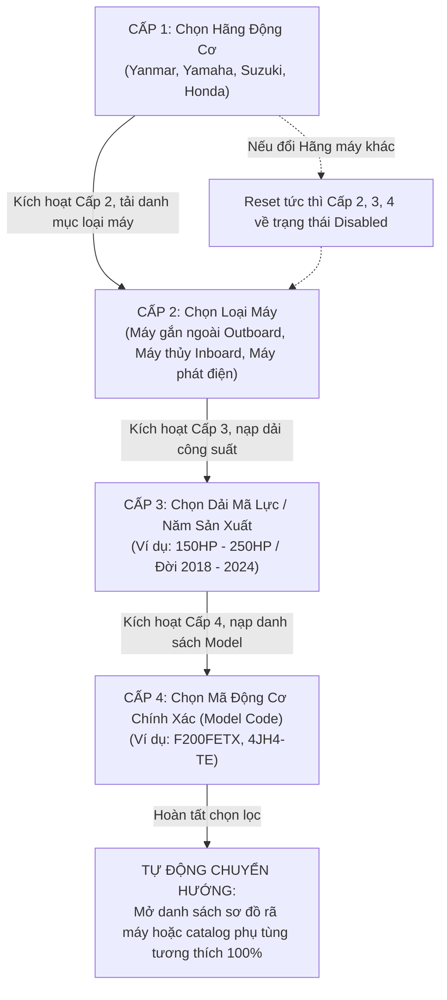
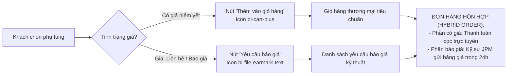

# JPM CLIENT – TÀI LIỆU 04: INTERACTION SYSTEM (HỆ THỐNG TƯƠNG TÁC VÀ PHẢN HỒI KỸ THUẬT)
**Dự án:** Japan Marine Parts Management (JPM)  
**Phân hệ:** Frontend Client Web  
**Giai đoạn:** Phase 3 – Unified Design System & Client Design Blueprint  
**Phiên bản tài liệu:** 1.0.0-2026  
**Trạng thái:** CHÍNH THỨC TRÌNH DUYỆT (Zero Source Code Modified)

---

## 1. NGUYÊN TẮC TƯƠNG TÁC (INTERACTION PRINCIPLES 2026)

Hệ thống thương mại điện tử công nghệ máy thủy JPM yêu cầu tương tác phải đạt 3 tiêu chuẩn cốt lõi:
1. **Dứt khoát & Chuẩn xác (Deterministic & Crisp):** Thời gian chuyển động (transition duration) tối ưu trong khoảng **150ms – 250ms**. Không sử dụng chuyển động rườm rà, trễ nải (bouncy/sluggish animations) làm chậm thao tác tra cứu của thợ máy.
2. **Phản hồi tức thì (Instant Visual Feedback):** Bất kỳ cú click, hover hay chạm cảm ứng đều phải tạo ra thay đổi trạng thái thị giác ngay trong 1 frame đầu tiên (16ms).
3. **Bảo toàn trạng thái (State Preservation):** Khi người dùng chuyển đổi qua lại giữa sơ đồ bản vẽ rã máy, danh sách phụ tùng và giỏ hàng, hệ thống không được làm mất các bộ lọc hay vị trí đang cuộn trang.

```
┌────────────────────────────────────────────────────────────────────────┐
│                     THANG THỜI GIAN VÀ ĐƯỜNG CONG TƯƠNG TÁC             │
├─────────────────────┬──────────────┬───────────────────┬───────────────┤
│ MỨC ĐỘ TƯƠNG TÁC    │ THỜI GIAN    │ TIMING FUNCTION   │ ỨNG DỤNG      │
├─────────────────────┼──────────────┼───────────────────┼───────────────┤
│ Micro-feedback      │ 150ms        │ ease-out          │ Button active,│
│ (Nút bấm, Checkbox) │              │                   │ Tag click     │
├─────────────────────┼──────────────┼───────────────────┼───────────────┤
│ Standard Surface    │ 200ms        │ cubic-bezier(     │ Card hover,   │
│ (Bay nổi card, menu)│              │ 0.16, 1, 0.3, 1)  │ Dropdown mở   │
├─────────────────────┼──────────────┼───────────────────┼───────────────┤
│ Structural Motion   │ 300ms        │ cubic-bezier(     │ Modal popup,  │
│ (Modal, Offcanvas)  │              │ 0.16, 1, 0.3, 1)  │ Drawer trượt  │
└─────────────────────┴──────────────┴───────────────────┴───────────────┘
```

---

## 2. QUY TRÌNH TƯƠNG TÁC BỘ LỌC ĐỘNG CƠ 4 CẤP (CASCADING FILTER UX FLOW)

Bộ lọc động cơ hàng hải là "cửa ngõ" quan trọng nhất để tìm đúng phụ tùng. Người dùng phải trải qua luồng chọn logic chặt chẽ:



### 2.1. Trạng thái phản hồi của từng cấp:
- **Trạng thái Chờ (Disabled Pending):** Khi chưa chọn cấp cha, cấp con bị làm mờ 50%, hiển thị icon ổ khóa mỏng (`bi-lock`) hoặc thông báo *"Vui lòng chọn bước trước"*.
- **Trạng thái Đang nạp (Loading Skeleton):** Khi cấp cha vừa được chọn, ô dropdown con lập tức xoay icon spinner mỏng (`bi-arrow-repeat spin`) trong 200-400ms khi API trả về kết quả.
- **Trạng thái Tự động kích hoạt (Auto-Advance):** Trên Desktop, khi chọn xong Cấp 1, tiêu điểm focus tự động mở menu Cấp 2 giúp thợ máy thao tác liền mạch chỉ bằng bàn phím.

---

## 3. TƯƠNG TÁC TRA CỨU MÃ OEM TỨC THÌ (INSTANT OEM SEARCH UX)

```
┌────────────────────────────────────────────────────────────────────────┐
│ [🔍 688-45941                                            ]  [Phím ESC] │
├────────────────────────────────────────────────────────────────────────┤
│ KẾT QUẢ TRA CỨU TỨC THÌ (3 phụ tùng khớp mã chính xác):                │
│                                                                        │
│ 1. ⚙️ 688-45941-01-EL | Cánh chân vịt nhôm Yamaha 11-1/2 x 13          │
│    Model: 40HP - 55HP (2T/4T) | Còn hàng: 12 cái | 3.850.000 đ        │
│                                                                        │
│ 2. ⚙️ 688-45941-02-EL | Cánh chân vịt nhôm Yamaha 11-1/4 x 14          │
│    Model: 40HP - 55HP (2T/4T) | Còn hàng: 4 cái  | 3.920.000 đ        │
│                                                                        │
│ 3. ⚠️ 688-45941-00-00 (MÃ CŨ ĐÃ THAY THẾ BỞI: 688-45941-01-EL)        │
│    Trạng thái: Superseded | Đã chuyển sang mã mới                      │
├────────────────────────────────────────────────────────────────────────┤
│ [↵ Bấm Enter để xem toàn bộ 14 kết quả cho "688-45941"]                │
└────────────────────────────────────────────────────────────────────────┘
```
- **Cơ chế Debounce:** Gửi request tra cứu sau **300ms** kể từ lần gõ phím cuối cùng nhằm bảo vệ tải API backend.
- **Tự động chuẩn hóa mã:** Người dùng gõ `6884594101` hoặc `688-45941-01`, hệ thống tự động nhận diện và match không phân biệt dấu gạch ngang và chữ hoa/thường.
- **Điều hướng phím:** Phím mũi tên $\downarrow$ và $\uparrow$ cho phép duyệt nhanh kết quả trong danh sách, phím `Enter` mở trang chi tiết phụ tùng ngay lập tức.

---

## 4. TRẢI NGHIỆM MÃ THAY THẾ (SUPERSESSION & OBSOLESCENCE UX)

Trong ngành phụ tùng hàng hải Nhật Bản, các hãng như Yanmar và Yamaha thường xuyên nâng cấp kỹ thuật, dẫn đến việc mã phụ tùng cũ bị khai tử và thay thế bằng mã mới (Supersession Chain). Trải nghiệm người dùng phải cực kỳ minh bạch để tránh thợ máy mua nhầm linh kiện cũ không còn lắp vừa:

```
┌────────────────────────────────────────────────────────────────────────┐
│                     CẢNH BÁO MÃ PHỤ TÙNG THAY THẾ                      │
├────────────────────────────────────────────────────────────────────────┤
│ ⚠️ THÔNG BÁO KỸ THUẬT QUAN TRỌNG:                                      │
│ Mã phụ tùng cũ bạn tìm kiếm: [ 688-45941-00 ]                          │
│ Đã được nhà sản xuất YAMAHA MOTOR thay thế chính thức bằng:            │
│                                                                        │
│ 👉 MÃ MỚI NHẤT: [ 688-45941-01-EL ] (Tương thích 100% về kích thước)  │
│                                                                        │
│ Cải tiến: Tăng cường hợp kim chống ăn mòn nước mặn cấp độ hàng hải.    │
│ ┌─────────────────────────────┐  ┌───────────────────────────────────┐ │
│ │ [ Xem chi tiết mã mới ➔ ]   │  │ [ Thêm mã mới vào giỏ hàng 🛒 ]   │ │
│ └─────────────────────────────┘  └───────────────────────────────────┘ │
└────────────────────────────────────────────────────────────────────────┘
```
- **Huy hiệu Supersession:** Màu tím công nghệ `#6D28D9` trên nền `#EDE9FE`, icon `bi-arrow-repeat`.
- **Trạng thái giỏ hàng:** Nếu người dùng nhấn thêm mã cũ, hệ thống tự động hiển thị modal xác nhận chuyển đổi sang mã thay thế mới nhất trước khi đưa vào giỏ.

---

## 5. TƯƠNG TÁC THƯƠNG MẠI & BÁO GIÁ ĐẶC BIỆT (CART & QUOTE INTERACTIONS)

Khách hàng JPM gồm cả chủ tàu mua lẻ (sản phẩm có giá niêm yết) và xưởng dịch vụ đặt linh kiện động cơ hiếm (cần báo giá theo số khung/tỷ giá). Do đó, giao diện giỏ hàng và thanh toán hỗ trợ 2 luồng song song:



### 5.1. Hiệu ứng Micro khi thêm vào giỏ:
- Khi nhấn nút `Thêm vào giỏ`:
  - Nút chuyển trạng thái thành công trong 600ms: Icon biến thành dấu tích xanh (`bi-check-lg`) kèm chữ *"Đã thêm!"*.
  - Huy hiệu số lượng trên Navbar (`Cart Badge`) có hiệu ứng rung nhẹ (pulse scale 1.25 trong 200ms) để thu hút ánh nhìn.
  - Một Toast Notification mỏng xuất hiện ở góc phải: *"Đã thêm Cánh chân vịt Yamaha vào giỏ hàng. [Xem giỏ hàng ➔]"*.

### 5.2. Đồng hồ đếm ngược hiệu lực báo giá (72-Hour Quote Countdown):
- Báo giá phụ tùng cơ khí nhập khẩu chịu ảnh hưởng của tỷ giá JPY/USD và cước vận chuyển hàng hải.
- Mỗi bảng báo giá trả về có hạn chót 72 giờ. Trên trang `TraCuuBaoGia.vue` và chi tiết tài khoản:
  - Hiển thị thanh đếm ngược thời gian thực (`Countdown Bar`).
  - Khi còn dưới 12 giờ: Chuyển màu vàng cam cảnh báo (`bi-hourglass-split`).
  - Khi hết hạn: Chuyển màu xám kèm nút `[Gửi yêu cầu gia hạn báo giá]`.

---

## 6. PHẢN HỒI THIẾT BỊ CẢM ỨNG (TOUCH FIDELITY GUIDELINES)

Đối với các kỹ sư máy và thợ sửa chữa sử dụng máy tính bảng hoặc điện thoại thông minh tại bến cảng:
- **Kích thước vùng chạm (Touch Target Size):** Mọi nút bấm, icon thao tác và dòng danh mục phụ tùng đều có chiều cao chạm tối thiểu **44px x 44px** (tuân thủ khuyến nghị Apple HIG và Google Material Design).
- **Tránh phụ thuộc vào Hover:** Toàn bộ thông tin quan trọng (giá, mã OEM, tồn kho) luôn hiển thị rõ ràng trên thẻ sản phẩm; hover chỉ dùng để tạo hiệu ứng nổi trang trí trên chuột máy tính để bàn.
- **Chống vô tình zoom trang khi click đúp:** Vùng bảng dữ liệu và sơ đồ rã máy thiết lập `touch-action: manipulation;` để ngăn trình duyệt tự động zoom loạn màn hình khi thao tác nhanh.
