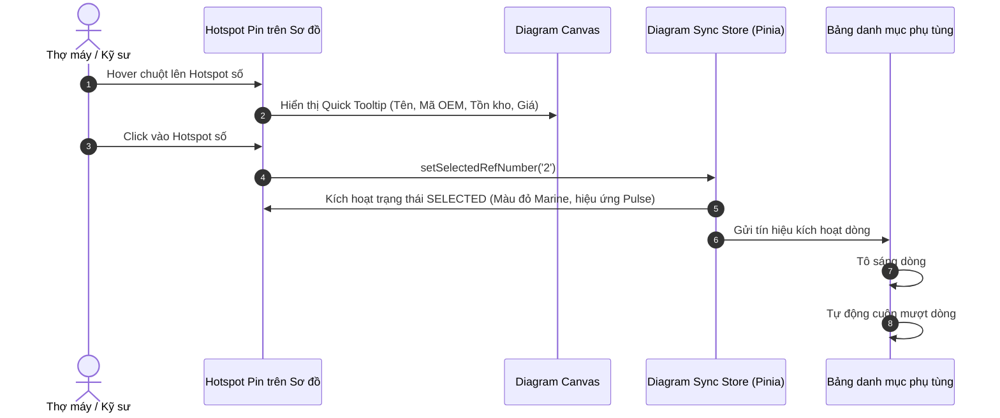
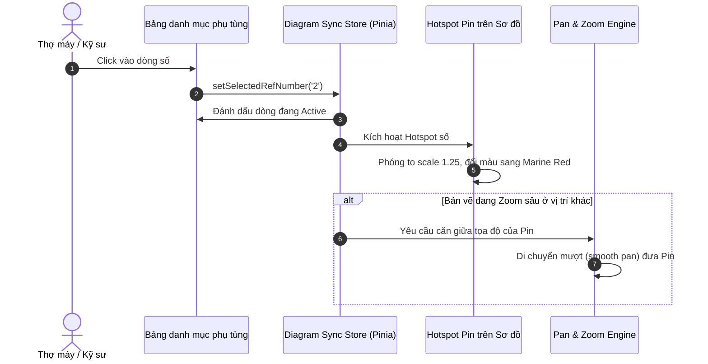

# JPM CLIENT – TÀI LIỆU 05: EXPLODED DIAGRAM UX & HOTSPOT ARCHITECTURE
**Dự án:** Japan Marine Parts Management (JPM)  
**Phân hệ:** Frontend Client Web  
**Giai đoạn:** Phase 3 – Unified Design System & Client Design Blueprint  
**Phiên bản tài liệu:** 1.0.0-2026  
**Trạng thái:** CHÍNH THỨC TRÌNH DUYỆT (Zero Source Code Modified)

---

## 1. BỐI CẢNH VÀ QUYẾT ĐỊNH PHÊ DUYỆT (PO DECISION 02 – OPTION A)

Exploded Parts Diagram (Bản vẽ rã máy chi tiết) là tính năng cốt lõi tạo nên lợi thế cạnh tranh của JPM trong lĩnh vực cung ứng phụ tùng máy thủy chuyên nghiệp.

### 1.1. Thực trạng kỹ thuật tại Phase 1 & Phase 2
- **Cơ sở dữ liệu Backend:** Bảng `chi_tiet_so_dos` đã có sẵn các trường dữ liệu tọa độ:
  - `ref_number`: Số thứ tự linh kiện trên bản vẽ (ví dụ: `1`, `2`, `14A`).
  - `qty`: Số lượng linh kiện lắp trên cụm máy.
  - `x`: Tọa độ ngang trục X (kiểu số thập phân phần trăm, ví dụ `42.50%`).
  - `y`: Tọa độ dọc trục Y (kiểu số thập phân phần trăm, ví dụ `68.10%`).
  - `width`, `height`: Kích thước vùng bao của phụ tùng (phần trăm).
  - Khóa ngoại `phu_tung_id` liên kết đầy đủ sang bảng `phu_tungs`.
- **Thiếu sót trên Frontend hiện tại:** File `SoDoPhuTung.vue` mới chỉ hiển thị ảnh tĩnh trong một thẻ `` kèm logic pan/zoom cơ bản, **chưa hề render các Hotspot Pin đè lên tọa độ** và **hoàn toàn chưa có cơ chế đồng bộ hai chiều (Two-way synchronization)** giữa bản vẽ và bảng danh mục phụ tùng.

---

## 2. KIẾN TRÚC TƯƠNG TÁC HAI CHIỀU (TWO-WAY INTERACTIVE SYNC ARCHITECTURE)

Hệ thống thiết lập một kênh đồng bộ trạng thái phản ứng (Reactive State Bridge) giữa Khung vẽ bản vẽ bên trái và Bảng danh mục phụ tùng bên phải:

```
┌────────────────────────────────────────────────────────────────────────────────────────────────────────┐
│                                   SO DO PHU TUNG - SPLIT WORKSPACE                                      │
├───────────────────────────────────────────────────────┬────────────────────────────────────────────────┤
│ KHUNG BẢN VẼ RÃ MÁY (DIAGRAM CANVAS - 55%)            │ BẢNG DANH MỤC PHỤ TÙNG (PART LIST TABLE - 45%) │
│                                                       │                                                │
│   [+] [-] [Fit] [⛶ Fullscreen]                        │ [🔍 Tìm kiếm mã OEM hoặc tên phụ tùng...]       │
│                                                       │ ┌────┬──────────────┬──────────────┬─────────┐ │
│          ┌──────────┐                                 │ │Số #│ Mã OEM       │ Tên phụ tùng │ Giá     │ │
│          │ [ 1 ]    │                                 │ ├────┼──────────────┼──────────────┼─────────┤ │
│          └────┬─────┘                                 │ │ 1  │ 688-45941-01 │ Cánh chân vịt│ 3.850k  │ │
│               │ (Hotspot Pin)                         │ ├────┼──────────────┼──────────────┼─────────┤ │
│   ┌───────────▼─────────────────────────────────────┐ │ │ 2  │ 90171-16011  │ Tán chân vịt │   120k  │ │
│   │ [PIN 2 (ĐANG CHỌN)]: Tán xẻ rãnh Yamaha         │ │ ├────┼──────────────┼──────────────┼─────────┤ │
│   │ Mã: 90171-16011 | Còn hàng: 25 cái | 120.000 đ  │ │ │ 3  │ 91490-30025  │ Chốt chẻ     │    15k  │ │
│   └─────────────────────────────────────────────────┘ │ └────┴──────────────┴──────────────┴─────────┘ │
└───────────────────────────────────────────────────────┴────────────────────────────────────────────────┘
```

### 2.1. Luồng tương tác 1: Thao tác từ Bản vẽ sang Bảng (Hotspot $\to$ Table)


### 2.2. Luồng tương tác 2: Thao tác từ Bảng sang Bản vẽ (Table $\to$ Hotspot)


---

## 3. CÔNG THỨC TOÁN HỌC ÁNH XẠ TỌA ĐỘ PHẦN TRĂM (COORDINATE MAPPING MATH)

Để đảm bảo vị trí các Hotspot Pin **không bao giờ bị lệch pixel** bất kể kích thước màn hình thay đổi hay khi người dùng kéo co giãn thanh Split Resizer:

### 3.1. Nguyên tắc đóng gói tỷ lệ phần trăm (Percentage-based Invariance)
Mọi tọa độ từ bảng `chi_tiet_so_dos` đều là giá trị tương đối so với kích thước gốc của ảnh sơ đồ (Original Natural Dimensions: $W_{orig} \times H_{orig}$):

$$\text{CSS Left} = x\%$$
$$\text{CSS Top} = y\%$$

```html
<!-- Cấu trúc DOM mẫu của Hotspot Pin -->
<div 
  class="jpm-hotspot-pin"
  :class="{
    'is-active': activeRef === item.ref_number,
    'is-hovered': hoverRef === item.ref_number,
    'is-disabled': !item.phu_tung_id
  }"
  :style="{
    left: item.x + '%',
    top: item.y + '%',
    transform: 'translate(-50%, -50%)'
  }"
  @mouseenter="onHoverPin(item)"
  @mouseleave="onLeavePin"
  @click="onSelectPin(item)"
>
  <span class="pin-number">{{ item.ref_number }}</span>
</div>
```

### 3.2. Bảo toàn vị trí khi Pan và Zoom (Matrix Transformation)
Khung vẽ sơ đồ bao gồm 2 lớp cấu trúc:
1. **Lớp ngoài (Viewport Window):** Cắt tràn viền `overflow: hidden; position: relative;`.
2. **Lớp trong (Transform Stage Layer):** Chứa cả Thẻ ảnh bản vẽ và Toàn bộ các Hotspot Pin cùng nằm chung trong một Container.
Khi Pan và Zoom, ma trận `transform: translate3d(panX, panY, 0) scale(currentZoom)` chỉ áp dụng lên Container chung này. Nhờ vậy:
- Tọa độ tương đối giữa Hotspot Pin và hình ảnh bản vẽ luôn được **khóa chặt 100%**, không xảy ra hiện tượng "ảnh phóng to một đằng, ghim nhảy một nẻo".

---

## 4. BẢNG TRẠNG THÁI VÀ ĐẶC TẢ THỊ GIÁC CỦA HOTSPOT PIN

| Trạng thái | Màu sắc Nền | Màu Chữ | Kích thước Pin | Hiệu ứng thị giác (Visual Effect) | Z-Index |
| :--- | :--- | :--- | :--- | :--- | :--- |
| **Default** | `--jpm-color-navy-dark` (`#0A1128`) | Trắng `#FFFFFF` | 24px x 24px | Viền trắng 1.5px, đổ bóng mỏng `--jpm-shadow-sm` | 10 |
| **Hover** | `--jpm-color-blue-electric` (`#0284C7`) | Trắng `#FFFFFF` | 28px x 28px | Nở rộng scale 1.15, mở Tooltip xem nhanh linh kiện | 50 |
| **Selected** | `--jpm-color-red-marine` (`#F82249`) | Trắng `#FFFFFF` | 30px x 30px | **Vòng tròn sóng phát sáng (Pulsing radar wave)** | 100 |
| **Unavailable / Disabled** | Slate-400 (`#94A3B8`) | Slate-700 | 22px x 22px | Nền mờ 60%, nét đứt, tooltip *"Chưa có dữ liệu linh kiện"*| 5 |

```
    [TRẠNG THÁI DEFAULT]            [TRẠNG THÁI SELECTED]
          ┌───┐                         ( ( ┌───┐ ) )  <-- Radar pulse wave
          │ 4 │                             │ 4 │
          └───┘                             └───┘
       Nền Navy #0A1128               Nền Đỏ Marine #F82249
       Kích thước 24px                Kích thước 30px
```

---

## 5. BỘ ĐIỀU KHIỂN BẢN VẼ (DIAGRAM TOOLBAR CONTROLS)

Thanh công cụ điều khiển bản vẽ được thiết kế dạng Floating Island nổi phía trên góc sơ đồ với hiệu ứng kính mờ `backdrop-filter: blur(8px)`:

```
┌────────────────────────────────────────────────────────────────────────┐
│ [🔍+ Phóng to]  [🔍- Thu nhỏ]  [↺ 100%]  [⛶ Toàn màn hình]  [ℹ Hướng dẫn]│
└────────────────────────────────────────────────────────────────────────┘
```
- **Zoom In / Out:** Tăng/giảm mức phóng đại mỗi nấc 25% (giới hạn từ 50% đến 400%).
- **Fit View (Nút vừa màn hình):** Tự động tính toán để toàn bộ bản vẽ hiển thị trọn vẹn trong khung nhìn.
- **Toggle Fullscreen:** Chuyển sang chế độ toàn màn hình không có Navbar để thợ máy có không gian tối đa quan sát chi tiết cụm trục láp, hộp số.
- **Split View Resizer:** Thanh kéo dọc giữa 2 cột có vạch khía kỹ thuật, cho phép thợ máy kéo sang trái/phải để mở rộng diện tích bản vẽ theo ý muốn.

---

## 6. THÍCH ỨNG TRÊN THIẾT BỊ DI ĐỘNG & MÀN HÌNH CẢM ỨNG (MOBILE UX)

Trên màn hình điện thoại dưới 768px, việc chia đôi 2 cột song song là không khả thi vì bản vẽ sẽ bị quá nhỏ. Hệ thống chuyển đổi sang mô hình **Tabbed Workspace + Bottom Drawer**:

```
┌────────────────────────────────────────────────────────┐
│ [TAB 1: 🗺️ BẢN VẼ RÃ MÁY]    [TAB 2: 📋 DANH MỤC (48)]  │
├────────────────────────────────────────────────────────┤
│ (Màn hình hiển thị bản vẽ toàn chiều rộng)             │
│ Hỗ trợ cử chỉ 2 ngón tay: Pinch-to-zoom & Pan vuốt     │
│                                                        │
│                                                        │
│ ┌────────────────────────────────────────────────────┐ │
│ │ ⚓ PHỤ TÙNG ĐANG CHỌN: #2 Tán xẻ rãnh               │ │
│ │ Mã OEM: 90171-16011 | Giá: 120.000 đ               │ │
│ │ ┌───────────────────┐  ┌─────────────────────────┐ │ │
│ │ │ [Chi tiết]        │  │ [🛒 Thêm giỏ]           │ │ │
│ │ └───────────────────┘  └─────────────────────────┘ │ │
│ └────────────────────────────────────────────────────┘ │
│ (Bottom Sheet trượt lên từ cạnh dưới khi chạm vào Pin) │
└────────────────────────────────────────────────────────┘
```
1. **Chuyển Tab nhanh:** Thợ máy có thể chuyển qua lại giữa chế độ xem bản vẽ và chế độ xem bảng tra cứu.
2. **Bottom Sheet linh kiện:** Khi chạm ngón tay vào một Hotspot Pin bất kỳ trên bản vẽ, một thẻ tóm tắt linh kiện sẽ trượt nhẹ từ dưới lên (Bottom Sheet cao khoảng 160px), hiển thị đầy đủ tên, mã OEM, giá và nút Thêm vào giỏ mà không che khuất vị trí bản vẽ đang nhìn.
3. **Thao tác 2 ngón tay:** Tích hợp bộ lắng nghe sự kiện `touchstart`, `touchmove`, `touchend` để nhận diện thao tác chụm/mở 2 ngón tay (Pinch) để phóng to thu nhỏ bản vẽ mượt mà.

---

## 7. TỐI ƯU HIỆU NĂNG CHO BẢN VẼ HÀNG TRĂM HOTSPOT (PERFORMANCE SPEC)
- Những cụm động cơ phức tạp như Cụm đầu bò (Cylinder Head) hay Cụm hộp số (Gearcase) có thể chứa từ 60 đến 120 Hotspot Pin.
- Để đảm bảo tốc độ đạt chuẩn **60 FPS** khi di chuyển kéo thả:
  - Tất cả các Hotspot Pin đều khai báo CSS `will-change: transform;` và `contain: layout style;` để trình duyệt phân tách thành các GPU Composit Layer riêng biệt.
  - Sự kiện cuộn bảng danh mục (`scrollIntoView`) được bọc trong hàm `requestAnimationFrame` để tránh hiện tượng nghẽn luồng xử lý chính (Layout Thrashing).
