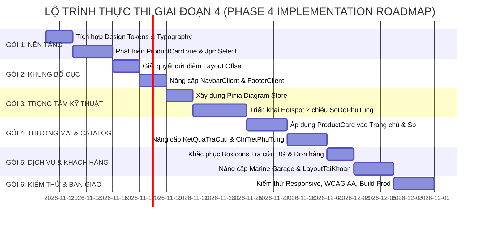

# JPM CLIENT – BÁO CÁO TỔNG KẾT PHASE 3: MASTER DESIGN BLUEPRINT & UNIFIED DESIGN SYSTEM 2026
**Dự án:** Japan Marine Parts Management (JPM)  
**Phân hệ:** Frontend Client Web  
**Giai đoạn:** Phase 3 – Unified Design System & Client Design Blueprint  
**Tác giả:** Đội ngũ Kiến trúc sư Phần mềm & Thiết kế Sản phẩm Kỹ thuật số JPM  
**Ngày hoàn thành:** 09/11/2026  
**Trạng thái:** HOÀN THÀNH TOÀN DIỆN – SẴN SÀNG TRÌNH DUYỆT PRODUCT OWNER  
**Nguyên tắc kỷ luật:** TUYỆT ĐỐI TUÂN THỦ NGUYÊN TẮC ZERO SOURCE CODE MODIFIED (Không chỉnh sửa bất kỳ dòng code nào trong Phase 3)

---

## 1. TỔNG KẾT CÁC HẠNG MỤC ĐÃ HOÀN THÀNH TRONG PHASE 3

Đội ngũ chuyên gia cấp cao đã hoàn thành trọn vẹn 100% mục tiêu của Phase 3, thiết lập một hệ thống tài liệu thiết kế và kiến trúc đồng bộ, khoa học, có tính khả thi kỹ thuật tuyệt đối, bao gồm 10 tập tài liệu chuyên khảo đặt tại thư mục:  
`c:\xampp\htdocs\JPM\JPM_PHASE_3_UNIFIED_DESIGN_SYSTEM/`:

```
JPM_PHASE_3_UNIFIED_DESIGN_SYSTEM/
├── 01_DESIGN_FOUNDATION.md              (Hệ màu, Font chữ, Bo góc, Đổ bóng, Spacing, Icons)
├── 02_GLOBAL_LAYOUT_SYSTEM.md          (Giải quyết dứt điểm lỗi Layout Offset & Header cố định)
├── 03_COMPONENT_LIBRARY.md             (Đặc tả ProductCard.vue, JpmSelect.vue & 22 khối UI)
├── 04_INTERACTION_SYSTEM.md            (Tương tác bộ lọc 4 cấp, Tra cứu OEM, Supersession)
├── 05_EXPLODED_DIAGRAM_UX_SPEC.md      (Kiến trúc Hotspot tương tác hai chiều trên bản vẽ rã máy)
├── 06_PAGE_DESIGN_BLUEPRINT.md         (Bản thiết kế chi tiết toàn bộ 20 màn hình Client)
├── 07_RESPONSIVE_SYSTEM.md             (Quy chuẩn thích ứng từ Mobile ngoài cảng đến Desktop 2K)
├── 08_ACCESSIBILITY_GUIDELINES.md      (Tiêu chuẩn tiếp cận WCAG 2.1 Cấp độ AA)
├── 09_TECHNICAL_IMPLEMENTATION_SPEC.md (Đặc tả khả năng triển khai Vue 3, Pinia, Vue Query)
├── 10_DESIGN_DECISION_LOG.md           (Nhật ký phê duyệt PO & Các điểm đề xuất mở rộng)
└── PHASE_3_MASTER_REPORT.md            (Báo cáo tổng luận điều hành)
```

---

## 2. HỆ THỐNG THIẾT KẾ CHÍNH THỨC ĐƯỢC THIẾT LẬP (UNIFIED DESIGN SYSTEM 2026)

### 2.1. Định vị và Tuyên ngôn Thiết kế
> **"MODERN LUXURY MARINE TECHNOLOGY E-COMMERCE"**  
> *"Tối giản đường nét – Tối đa khoảng thở – Chính xác kỹ thuật – Đậm chất biển sâu."*

Hệ thống kết hợp tinh thần công nghệ cơ khí máy thủy chuẩn xác của Nhật Bản với trải nghiệm du thuyền cao cấp (Marine Luxury), loại bỏ hoàn toàn cảm giác website Bootstrap thô cứng cũ kỹ.

### 2.2. Các Design Tokens cốt lõi
1. **Bảng màu định danh:**
   - Primary: Deep Navy `#0A1128` (Biển sâu huyền bí, uy quyền).
   - Secondary: Navy Subtle `#101E42` (Tầng biển nổi).
   - Brand Accent / Primary CTA: Marine Red `#F82249` (Màu đỏ cứu sinh hàng hải & nhiệt huyết công nghệ).
   - Technical Action: Electric Blue `#0284C7` (Xanh kỹ thuật).
   - Luxury Accent: Metallic Marine Gold `#D97706` (Ánh đồng chân vịt hàng hải).
   - Surface Nền: Slate Neutral Scale từ `#0F172A` đến `#F8FAFC` và Nền thẻ trắng `#FFFFFF`.
2. **Typography System:**
   - Tiêu đề & Thương hiệu: **Raleway** (Geometric Sans Marine Luxury).
   - Nội dung, Nhãn & Biểu mẫu: **Roboto** (Tối ưu tính dễ đọc).
   - Mã OEM, Thông số & Bảng giá: **Roboto Mono & Tabular Numbers** (`font-variant-numeric: tabular-nums`).
3. **Hệ thống Bo góc chuẩn mực (PO Decision 01):**
   - Card sản phẩm, Khung Panel, Modal: **`12px`**.
   - Nút bấm, Ô nhập liệu, Dropdown menu: **`8px`**.
   - Huy hiệu Tag, Badge trạng thái, Chip lọc: **`6px`**.
   - Avatar người dùng, Nút icon tròn: **`50%`**.
4. **Hệ thống Đổ bóng mỏng:**
   - Thay thế bóng đen đục bằng dải bóng xanh navy mờ khuếch tán: `--jpm-shadow-sm` (tĩnh), `--jpm-shadow-md` (hover nổi 4px), `--jpm-shadow-lg` (dropdown/tooltip).

---

## 3. TỔNG HỢP CÁC QUYẾT ĐỊNH ĐÃ ĐƯỢC PRODUCT OWNER PHÊ DUYỆT

| Mã quyết định | Nội dung quyết định | Giải pháp kiến trúc thực thi trong Phase 3 |
| :--- | :--- | :--- |
| **PO DECISION 01** | Chốt Phương án A cho **Border Radius** | Chuẩn hóa 4 cấp độ: `12px` (Card) / `8px` (Controls) / `6px` (Badges) / `50%` (Circle). Triệt tiêu 15 mức bo góc lộn xộn cũ. |
| **PO DECISION 02** | Chốt Phương án A cho **Interactive Hotspots** | Xây dựng kênh đồng bộ 2 chiều (Two-way Reactive Bridge) giữa Ghim bản vẽ và Bảng danh mục; sử dụng tọa độ phần trăm từ `chi_tiet_so_dos` kết hợp Pan/Zoom không lệch pixel. |
| **PO DECISION 03** | Chốt Phương án A cho **Shared Components** | Đặc tả hoàn chỉnh `ProductCard.vue` (khắc phục dứt điểm lỗi khuyết nút giỏ hàng khi báo giá) và `JpmSelect.vue` (hỗ trợ chuỗi lọc phụ thuộc 4 cấp mượt mà). |
| **PO DECISION 04** | Chốt Phương án A cho **Icon System** | Thống nhất 100% Bootstrap Icons (`bi bi-*`), loại bỏ và thay thế toàn bộ 41 vị trí lỗi font Boxicons (`bx bx-*`) trên Client. |

---

## 4. TỔNG HỢP CÁC ĐIỂM ĐỀ XUẤT ĐANG CHỜ PRODUCT OWNER DUYỆT (PENDING VALIDATION)

Đội ngũ kiến trúc sư trân trọng đề xuất 4 điểm sau để PO xem xét trước khi bấm nút khởi động Phase 4:
1. **DEC-PENDING-01 (Quy trình Đơn hàng Hỗn hợp):** Đề xuất cho phép tách đơn lai – Khách hàng có thể thanh toán cọc cho phụ tùng có sẵn và đồng thời gửi yêu cầu báo giá cho phụ tùng hiếm trong cùng 1 giỏ hàng.
2. **DEC-PENDING-02 (Sơ đồ rã máy trên Mobile hẹp < 400px):** Đề xuất áp dụng mô hình **Tabbed Workspace** (Tab Sơ đồ Pinch-Zoom + Tab Bảng danh mục) kết hợp thanh trượt Bottom Sheet linh kiện nổi.
3. **DEC-PENDING-03 (Phạm vi ô tìm kiếm nhanh Header):** Đề xuất hỗ trợ tìm kiếm đa năng gồm Mã OEM, Tên phụ tùng và Số khung động cơ (Serial Model).
4. **DEC-PENDING-04 (Chế độ Dark Mode):** Đề xuất tập trung tối đa cho giao diện Deep Navy + Slate Surface chuẩn trong Phase 4, tính năng chuyển đổi Marine Night Deck Dark Mode sẽ phát triển trong Phase 5.

---

## 5. TỔNG KẾT KHẢ NĂNG THI KÔNG KỸ THUẬT (TECHNICAL FEASIBILITY)

- **Công nghệ Frontend:** Tương thích 100% với Vue 3 Composition API, Vite v8, Pinia Store và TanStack Vue Query hiện có trong `FE_JPM`.
- **Hệ thống CSS:** Các Design Tokens được thiết kế độc lập dưới dạng CSS Custom Properties (`--jpm-*`), cho phép đưa vào sử dụng song song mà không gây phá vỡ 3.569 dòng CSS của `main.css`.
- **Backend & Database:** Không đòi hỏi bất kỳ sự thay đổi nào đối với Laravel 12 Backend hay 89 bảng Database. Các trường tọa độ `x, y, width, height` trong bảng `chi_tiet_so_dos` và endpoint `/api/public/so-do-model/{modelCode}` đã sẵn sàng để tiêu thụ ngay lập tức.
- **Tính toán tài chính:** Cơ chế Định giá Thẩm quyền (Authoritative Pricing) từ Backend được bảo toàn trọn vẹn.

---

## 6. KẾ HOẠCH TRIỂN KHAI CHI TIẾT PHASE 4 (PHASE 4 ACTION PLAN)

Khi được Product Owner chính thức phê duyệt, Phase 4 sẽ được thực thi theo 6 gói công việc (Work Packages / Sprints) tuần tự, an toàn và có thể kiểm thử từng phần:



### Chi tiết 6 Gói công việc:
1. **Gói WP-01: Foundation & Shared Components**
   - Tạo file `FE_JPM/src/assets/css/design-tokens.css` chứa toàn bộ biến màu sắc, bo góc (12/8/6/50%), spacing, typography.
   - Xây dựng component `ProductCard.vue` đạt chuẩn phân cấp thị giác và cân bằng nút báo giá.
   - Xây dựng component `JpmSelect.vue` hỗ trợ tìm kiếm và chuỗi lọc phụ thuộc 4 cấp.
2. **Gói WP-02: Global Layout & Header Offset Fix**
   - Loại bỏ toàn bộ `style="padding-top: 110px;"` inline tại tất cả các file màn hình con.
   - Thiết lập cơ chế bù trừ khoảng đệm tập trung tại `LayoutClient.vue` theo biến `--jpm-header-height` (80px desktop, 72px tablet, 64px mobile).
   - Nâng cấp `NavbarClient.vue` và `FooterClient.vue` theo phong cách Deep Marine sang trọng.
3. **Gói WP-03: Exploded Diagram Hotspot Interactive Engine**
   - Tạo store Pinia `useDiagramStore.ts` đồng bộ trạng thái giữa Bản vẽ và Bảng dữ liệu.
   - Viết component `HotspotPin.vue` ánh xạ tọa độ phần trăm, hiệu ứng hover, radar pulse khi chọn.
   - Tích hợp điều khiển Pan, Zoom mượt mà và thanh kéo Split Resizer tại `SoDoPhuTung.vue`.
4. **Gói WP-04: Catalog, Search & Product Views**
   - Thay thế toàn bộ code thẻ sản phẩm trùng lặp trên `TrangChu.vue`, `SanPham.vue`, `ThuongHieu.vue`, `KetQuaTraCuu.vue` bằng `ProductCard.vue`.
   - Nâng cấp trải nghiệm xem chi tiết phụ tùng tại `ChiTietPhuTung.vue` và `ChiTietSanPham.vue`.
5. **Gói WP-05: Quotation, Orders & Marine Garage**
   - Thay thế 100% các class `bx bx-*` bằng Bootstrap Icons `bi bi-*` tại `TraCuuBaoGia.vue` và `TraCuuDonHang.vue`.
   - Chuẩn hóa giao diện giỏ hàng `GioHang.vue` và các trang tủ máy `Garage.vue`, `GarageChiTietMay.vue`.
6. **Gói WP-06: Verification, Accessibility & Performance Audit**
   - Chạy kiểm thử tự động build Vite `npm run build` không lỗi cảnh báo.
   - Kiểm tra tương thích hiển thị trên 5 breakpoint (`xs` đến `xxl`).
   - Rà soát độ tương phản màu sắc đạt chuẩn WCAG 2.1 AA.

---

## 7. TIÊU CHÍ NGHIỆM THU PHASE 4 (ACCEPTANCE CRITERIA)

Dự án chỉ được nghiệm thu khi đạt đủ 6 tiêu chí kỹ thuật định lượng:
- [ ] **Tiêu chí 1:** Lệnh `npm run build` chạy thành công 100%, không phát sinh lỗi cú pháp hay thiếu import.
- [ ] **Tiêu chí 2:** Triệt tiêu 100% các lỗi icon Boxicons hỏng (0 biểu tượng ô vuông lỗi trên toàn hệ thống).
- [ ] **Tiêu chí 3:** Triệt tiêu 100% các dòng code `style="padding-top: 110px;"` chắp vá trong các file Vue con.
- [ ] **Tiêu chí 4:** Mọi bo góc trên giao diện tuân thủ chính xác 4 mức `12px`, `8px`, `6px`, `50%`.
- [ ] **Tiêu chí 5:** Bản vẽ rã máy `SoDoPhuTung.vue` click vào ghim nhảy đúng dòng trên bảng, click dòng trên bảng làm sáng đúng ghim trên bản vẽ.
- [ ] **Tiêu chí 6:** Thẻ sản phẩm `ProductCard.vue` hiển thị cân đối hoàn hảo cả khi có giá lẫn khi cần báo giá.

---

## 8. TUYÊN BỐ DỪNG LẠI & CHỜ PHÊ DUYỆT (OFFICIAL SIGN-OFF REQUEST)

> [!IMPORTANT]
> **ĐỘI NGŨ THIẾT KẾ ĐÃ HOÀN TẤT TRỌN VẸN PHASE 3 VÀ CHÍNH THỨC DỪNG LẠI TẠI ĐÂY.**  
> - **TUYỆT ĐỐI KHÔNG TỰ Ý CHUYỂN SANG PHASE 4 KHI CHƯA CÓ LỆNH.**  
> - **TUYỆT ĐỐI KHÔNG CHỈNH SỬA BẤT KỲ FILE SOURCE CODE NÀO CỦA DỰ ÁN TRONG SUỐT GIAI ĐOẠN NÀY.**

Kính trình **Product Owner** xem xét bộ hồ sơ thiết kế định hướng tại thư mục `JPM_PHASE_3_UNIFIED_DESIGN_SYSTEM/` và cho ý kiến phê duyệt để đội ngũ có thể tiến hành triển khai mã nguồn tại Phase 4!
